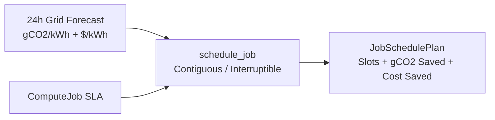

# grid-carbon

[](https://github.com/codesphere-u/grid-carbon/actions/workflows/ci.yml)
[](LICENSE)
[](pyproject.toml)
[](pyproject.toml)

**Time-of-use marginal grid carbon intensity & solar-peak batch workload scheduler quantifying exact `gCO₂eq` emissions and tariff cost savings for ML, CI, and ETL jobs.**

- **Mission Domain:** Energy Efficiency & Green Software Engineering
- **Stack:** Pure Python 3.11+ (zero runtime third-party dependencies, `mypy --strict`, `ruff`, `pytest`)
- **Maintainer:** Codesphere Innovations (U) Limited (`codesphere-u`)

---

## Problem Solved

Batch ML training, ETL pipelines, and CI suites run blindly during fossil-peaker evening hours when shifting them into midday solar or off-peak hydro troughs cuts both carbon emissions and power bills by 60–80%.

## Key Features

- Multi-objective normalized carbon + electricity tariff window optimizer (`schedule_job`).
- Supports both strict contiguous SLA windows and checkpoint-interruptible workloads.
- Quantifies exact `gCO₂eq` saved, carbon reduction percentage, and USD tariff savings versus immediate execution.

## Architecture Overview



See [docs/architecture.md](docs/architecture.md) for module-level design details.

## Installation

```bash
git clone https://github.com/codesphere-u/grid-carbon.git
cd grid-carbon
uv sync --extra dev
```

Or install in editable mode with standard `pip`:

```bash
pip install -e ".[dev]"
```

## Quick Start (CLI)

```bash
grid-carbon demo
```

## Quick Start (Python API)

```python
from grid_carbon import ComputeJob, GridSlot, schedule_job

plan = schedule_job(ComputeJob("etl", 2.0, 2, 0, 4), [GridSlot(0, "00", 500, 0.2), GridSlot(1, "01", 500, 0.2), GridSlot(2, "02", 80, 0.08), GridSlot(3, "03", 80, 0.08)])
assert plan.selected_slots == (2, 3)
```

## Testing & Quality Gates

```bash
uv run ruff check src tests
uv run mypy src
uv run pytest -v
```

## Security, Contributing & Roadmap

- **Security:** See [SECURITY.md](SECURITY.md) for responsible disclosure procedures.
- **Contributing:** See [CONTRIBUTING.md](CONTRIBUTING.md) and [CODE_OF_CONDUCT.md](CODE_OF_CONDUCT.md).
- **Changelog & Roadmap:** See [CHANGELOG.md](CHANGELOG.md) and [ROADMAP.md](ROADMAP.md).

## License

MIT License — see [LICENSE](LICENSE).

## Support & Contact

Open an issue on [GitHub Issues](https://github.com/codesphere-u/grid-carbon/issues) or contact `codesphereinnovationz@gmail.com`.
